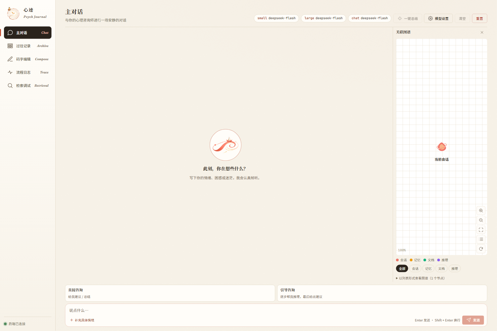

<h1 align="center">心迹 · Psych Journal</h1>

<p align="center"><em>日记 · 复盘 · 记忆 · 引导 · 成长</em><br>
<em>Journal · Reflection · Memory · Guidance · Growth</em></p>

<p align="center">
一处安静的写作与对话空间。你不必先整理好自己，再走进来。<br>
<em>A quiet place to write and talk. You don't have to be put together before you arrive.</em>
</p>

---

平凡的一天，你轻轻走过拂起的微风托着枫叶缓缓飘落  
多彩的一周，你静静深思落下的种子衬着柔光逐渐萌发  
翻起曾被抛之脑后的旧页，对话框前叙述着或是困惑，或是理想  
当背后看似没有感情的参数用你的体悟、你的过去让你的内心再度荡起涟漪  
让文字带你拾起你心底的那份真挚  

——每一天，用日记随记当下的经历与感受  
每一段日子，尝试让你的内心短暂驻足，用周复盘 问题-分析-解决策略 可视化自己的成长  
每一次寻知，用咨询带你冲出雾霭  
每一次不安或迷茫，用引导带你走进你的内心  

*An ordinary day—you pass gently by; the stirred breeze carries maple leaves drifting slowly down.*  
*A colorful week—you quietly reflect; fallen seeds, touched by soft light, gradually sprout.*  
*Turn again to old pages once cast from mind; before the dialogue box, you speak of confusion, or of ideals.*  
*When the seemingly emotionless parameters behind it all use your insights and your past to set ripples moving in your heart once more.*  
*Let words lead you to gather up the sincerity deep within.*  

*——Every day, use a diary to capture your experiences and feelings of the moment.*  
*For each stretch of days, let your heart pause briefly; use a weekly review—problem–analysis–solution strategy—to visualize your growth.*  
*Each time you seek knowledge, let consultation carry you out of the haze.*  
*Whenever you feel uneasy or lost, let guidance lead you into your inner world.*  

心迹，是心走过的痕迹。它不催促你，也不替你下结论。

*Psych Journal is the trace a heart leaves behind. It doesn't hurry you, and it doesn't decide for you.*

---

## 你可以做什么 · What you can do

你不需要先学会使用它。你只需要带来此刻的自己。

*You don't need to learn the app first. Bring the self you are today.*

### 01 写下今天 · Write today

打开「码字编辑」，写下今天发生的一件小事，或一次还没有想明白的感受。可以只写一句，不必有开头和结尾。

如果你愿意，每周留一个停顿，用「问题 · 分析 · 下一步」三个小段，把这一周轻轻放下来。

*Open **Compose**. Write about one small thing that happened today, or a feeling you haven't worked out yet. One sentence is enough; it doesn't need a beginning or an ending.*

*If you like, leave a pause each week. Use three small parts — the problem, what you noticed, and the next step — to set the week down gently.*

### 02 回看走过的日子 · Return to what you've written

打开「过往记录」，翻一翻自己写下的日常与周复盘。你不必一次读完，只挑一篇和现在的你有关的。

*Open **Archive**. Browse the days you've written and the weeks you've reviewed. You don't have to read it all. Choose one page that speaks to the person you are now.*

### 03 把一个问题带进来 · Bring a question

打开「主对话」，从一句没说完的话开始。你可以只是被听见，也可以选择一起，把事情想到更具体的地方。

*Open **Chat**. Begin with a sentence you haven't finished. You can ask to be heard, or ask to think something through together. Say what kind of company you need today.*

### 04 看见彼此的联系 · See the threads

打开「关联图谱」，看看一次对话旁边，出现了哪些旧记录和新的理解。点开一个节点，回到它原来的那一刻。

*Open the **graph**. See which old notes sit close to a conversation, and which new understandings have begun to gather around it. Click a node to return to the moment it came from.*

---

## 什么时候打开它 · When to open it

| 此刻 · Right now | 你可以 · You can |
| --- | --- |
| 心里很乱，不知道从哪说起<br>*Your mind is loud, and you don't know where to begin* | 写下三行。不要求完整，也不要求平静。<br>*Write three lines. They don't have to be complete, or calm.* |
| 一周过完，想给自己一个停顿<br>*The week is over, and you need a pause* | 做一次周复盘：问题、分析、下一步。<br>*Make a weekly review: the problem, what you noticed, the next step.* |
| 某个旧问题又回来<br>*An old question has returned* | 把它带进对话，看看现在的你怎么回答。<br>*Bring it into a conversation and see how today's you responds.* |
| 想看看自己走了多远<br>*You want to see how far you've come* | 打开记录与图谱，看看那些被连起来的时刻。<br>*Open Archive and the graph. See the moments that have been connected.* |

---

## 开始使用 · To begin

1. 克隆该目录。复制到命令行：
```bash
git clone git@github.com:fluffyTighnari/Psych_agent.git <你自己希望放的目录位置>
```
docker快速启动：安装docker后执行：
```bash
docker compose up -d --build
```
无docker可选择配置环境后启动：
```bash
python -m venv .venv
.venv\Scripts\activate
pip install -r requirements.txt
python main.py
```

2. 在「码字编辑」写下第一则日常。哪怕只有一句。
3. 一周后，给自己十分钟，做一次周复盘。
4. 当一个问题回来，把它带进「主对话」。

<br>

2. Write your first daily note in **Compose**. One sentence is enough.
3. A week later, give yourself ten minutes for a weekly review.
4. When a question returns, bring it into **Chat**.

---

## 界面一角 · A glance

<p align="center">
  
</p>

<p align="center"><sub>完整页面：主对话与关联图谱 · Full desktop page: conversation and connected notes</sub></p>

---

> 如果你不知道写什么，就从今天最想略过的那一句话开始。
>
> *If you don't know where to start, begin with the sentence you most want to skip.*

你不需要每天都有进展。有些日子，只是把自己接住，就已经够了。

*Not every day has to move you forward. Some days, simply holding yourself is enough.*

---

## 一句边界 · A note on care

心迹不是专业心理咨询或医疗服务的替代。如果你正处在伤害自己或他人的风险中，请先联系当地急救、危机热线，或身边可信任的人。

*Psych Journal is not a substitute for professional mental health care. If you are at risk of harming yourself or someone else, please contact local emergency services, a crisis line, or someone you trust.*
